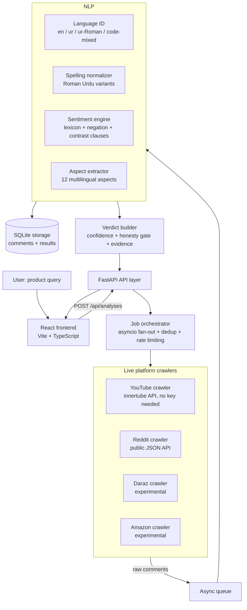

# Raye — Evidence-Based Product Review Sentiment Analysis

**Author:** Muhammad Hassaan Mustaqeem Awais (S2023376018)
**Repository:** https://github.com/HassaanAwais777/Raye

Raye is a real, working web application — not a static dataset project. You type a product name
(e.g. `Infinix Note 40`, `Airpods Pro 2`, `Xiaomi Redmi Note 13`), Raye **crawls real, live comments**
from product-review videos and discussions across multiple platforms, runs a **multilingual sentiment
pipeline** (English, Urdu script, **Roman Urdu**, and code-mixed text), and produces an
**evidence-based verdict** where every claim is traceable back to the exact source comment and video.

> **Honesty first:** if Raye could not collect enough real comments, it refuses to give a verdict and
> tells you exactly why and what to do next. It never fabricates a conclusion from thin data.

---

## Feature checklist (mapped to the project requirements)

| # | Requirement | Status | Where |
|---|-------------|--------|-------|
| 1 | Real-time data from the web (no static datasets) | ✅ | `backend/app/scraping/` — live HTTP crawlers |
| 2 | Multi-platform (not only YouTube) | ✅ | YouTube, Reddit (stable) + Daraz, Amazon (experimental adapters, pluggable registry) |
| 3 | English / Urdu / **Roman Urdu** / code-mixed support | ✅ | `backend/app/nlp/langid.py` |
| 4 | Spelling normalization (`bohat`/`bahut`/`bohot` → same meaning) | ✅ | `backend/app/nlp/normalize.py` |
| 5 | Sentiment per comment: positive / negative / mixed (+ neutral) | ✅ | `backend/app/nlp/sentiment.py` |
| 6 | Aspect-level analysis (battery, price, camera, …) | ✅ | `backend/app/nlp/aspects.py` |
| 7 | Traceability — every comment links back to its source video/post | ✅ | `comment_url` on every stored comment (YouTube links use `&lc=<comment id>` deep links) |
| 8 | Scales to 200,000+ crawled comments | ✅ | Async fan-out orchestrator + rate limiting + dedup; `RAYE_MAX_TOTAL_COMMENTS=200000` |
| 9 | Honesty mechanism when data is insufficient | ✅ | `backend/app/analysis/verdict.py` — `insufficient_evidence` verdict + recommendations |
| 10 | Real usable product-grade web app | ✅ | FastAPI backend + React (Vite + TypeScript) frontend, Dockerized |

---

## Architecture



### The NLP pipeline per comment

1. **Language ID** — Urdu-script detection, Roman-Urdu marker statistics, code-mixed detection.
2. **Normalization** — variant spellings collapse to one canonical form: `bohat / bahut / bohot / bhot / bht → bahut`, `nahi / nahin / nai / nhe → nahi`, `acha / accha / acca → achha`, texting forms `gr8 → great`, `plz → please`, repeated-letter collapse (`soooo → so`).
3. **Sentiment** — a transparent, auditable engine: multilingual weighted lexicon (English + Roman Urdu + Urdu script), negation windows that work in **both** orders (`"achha nahi hai"` and `"not good"`), intensifiers/diminishers (`bahut`, `very`, `thora`), and clause splitting on contrast words (`but`, `lekin`, `magar`, `balkay`) so *"camera acha hai lekin battery kharab hai"* is correctly tagged **mixed**.
4. **Aspect extraction** — 12 aspects (battery, camera, price/value, display, performance, software, audio, build/design, connectivity, delivery/service, accessories, general quality) with English + Roman Urdu + Urdu-script keyword sets; aspect sentiment comes from the clause that mentions the aspect.

## The honesty mechanism (why you can trust a Raye verdict)

A verdict is only produced when:

- **n ≥ `RAYE_MIN_RELIABLE_N`** (default 150) analyzed comments, **and**
- at least one platform returned data successfully (failed platforms are listed as warnings).

Otherwise Raye returns `status: "insufficient_evidence"` with a clear explanation and concrete
recommendations (raise the comment cap, enable more platforms, broaden the query). Even for
sufficient data, every verdict ships with:

- a **confidence score** decomposed into 4 explainable factors — sample size, verdict clarity, platform diversity, language coverage;
- **warnings** (e.g. failed platforms, experimental-only data, heuristic NLP disclosure);
- **evidence quotes** — real comments (positive / negative / mixed) with a direct link to the exact comment on the source video or post;
- per-aspect **insufficient-mentions** badges when an aspect has < `RAYE_MIN_ASPECT_MENTIONS` mentions.

## Scaling to 200,000+ comments

- The orchestrator fans out across all enabled platforms concurrently (`asyncio`), each adapter having its own **token-bucket rate limiter** and exponential-backoff retry.
- Comments stream through an async queue into the NLP pipeline in batches while crawling continues — fetching and analysis overlap.
- Exact-duplicate comments (same normalized text + author + platform) are removed on arrival.
- Set the ceiling with `RAYE_MAX_TOTAL_COMMENTS` (default `200000`) and the UI slider. Practical duration at that scale is hours (rate limiting is deliberate — be polite to platforms); 3–10k comments complete in minutes.

## Quickstart

### Option A — Docker (recommended)

```bash
docker compose up --build
# Frontend: http://localhost:3000   API: http://localhost:8000/docs
```

### Option B — Manual

```bash
# Backend
cd backend
python -m venv .venv && source .venv/bin/activate
pip install -r requirements.txt
uvicorn app.main:app --reload --port 8000

# Frontend (second terminal)
cd frontend
npm install
npm run dev   # http://localhost:5173 (proxies /api to :8000)
```

### CLI smoke test

```bash
curl -s -X POST http://localhost:8000/api/analyses \
  -H 'Content-Type: application/json' \
  -d '{"query":"Galaxy S24 review","platforms":["youtube","reddit"],"max_comments":500}'
# → {"job_id":"..."}
curl -s http://localhost:8000/api/analyses/<job_id> | jq .status
```

## API reference

| Method | Path | Description |
|--------|------|-------------|
| `GET`  | `/api/health` | Liveness + DB check |
| `GET`  | `/api/platforms` | Registered platform adapters + capability metadata |
| `POST` | `/api/analyses` | Start an analysis job: `{query, platforms?, max_comments?, sources_per_platform?, comments_per_source?, sort?}` |
| `GET`  | `/api/analyses` | Recent analyses (history) |
| `GET`  | `/api/analyses/{job_id}` | Job status, live progress, and the full result when done |
| `GET`  | `/api/analyses/{job_id}/comments?sentiment=&lang=&aspect=&page=&page_size=` | Paginated, filterable analyzed comments with full traceability |

Interactive docs: `http://localhost:8000/docs` (Swagger UI).

## Configuration (env vars — see `.env.example`)

| Variable | Default | Purpose |
|----------|---------|---------|
| `RAYE_MAX_TOTAL_COMMENTS` | `200000` | Hard ceiling on comments per analysis |
| `RAYE_MIN_RELIABLE_N` | `150` | Below this → `insufficient_evidence` verdict |
| `RAYE_MIN_ASPECT_MENTIONS` | `30` | Minimum mentions before an aspect score is trusted |
| `RAYE_DB_PATH` | `./raye.db` | SQLite location |
| `RAYE_YT_VIDEOS_PER_QUERY` / `RAYE_YT_COMMENTS_PER_VIDEO` | `10` / `150` | YouTube crawl shape |
| `RAYE_REDDIT_POSTS_PER_QUERY` / `RAYE_REDDIT_COMMENTS_PER_POST` | `15` / `100` | Reddit crawl shape |
| `RAYE_REQUEST_TIMEOUT` | `20` | Per-request timeout (seconds) |

## Project structure

```
Raye/
├── backend/
│   ├── app/
│   │   ├── main.py               # FastAPI app
│   │   ├── config.py             # Settings from env
│   │   ├── schemas.py            # Request/response models
│   │   ├── db.py                 # SQLite persistence
│   │   ├── nlp/                  # langid · normalize · lexicons · sentiment · aspects · pipeline
│   │   ├── scraping/             # base · ratelimit · youtube · reddit · daraz · amazon · registry · orchestrator
│   │   ├── analysis/verdict.py   # aggregation, confidence, honesty gate, evidence
│   │   └── api/routes.py         # REST endpoints
│   ├── tests/                    # pytest suite (NLP, verdict honesty gate, crawler parsers)
│   ├── requirements.txt
│   └── Dockerfile
├── frontend/
│   ├── src/                      # React + TypeScript UI (verdict dashboard, evidence, comments)
│   ├── package.json · vite.config.ts
│   ├── Dockerfile · nginx.conf
├── docs/PROJECT_SUMMARY.docx     # 2-page project summary
├── docker-compose.yml · .env.example · LICENSE · .github/workflows/ci.yml
```

## Testing

```bash
cd backend && python -m pytest tests -q
```

Covers: spelling normalization variants, sentiment (English / Roman Urdu / Urdu script / mixed /
negation), aspect extraction, language ID, the honesty gate, and the YouTube response parsers
(fixture-based, no network needed).

## Known limitations (stated honestly)

- Sentiment uses a **lexicon + rules engine** — transparent and auditable, but weaker than a
  fine-tuned transformer on sarcasm and heavy slang. The `SentimentEngine` interface is designed so a
  transformer backend (e.g. XLM-R fine-tuned on Roman Urdu) can be dropped in.
- **Daraz and Amazon adapters are experimental**: both sites change markup frequently and use
  aggressive bot protection. Failures degrade gracefully and are surfaced as warnings, never silently ignored.
- **Reddit blocks datacenter IPs** (cloud/CI environments get `403`). From a normal residential
  connection or with proxies the public JSON API works fine; from servers Raye reports it as a
  failed platform warning and continues with the others.
- YouTube relative timestamps ("3 weeks ago") are converted to approximate dates.

## Roadmap

1. Fine-tune XLM-R / MuRIL on a Roman Urdu sentiment corpus; blend with the lexicon engine.
2. Adapters for TikTok and X/Twitter comments; browser-extension capture for arbitrary sites.
3. Review **helpfulness model** (down-weight one-word spam) and bot-account filtering.
4. Aspect trend comparison across product generations ("battery improved vs Note 12?").

## License

MIT © 2026 Muhammad Hassaan Mustaqeem Awais
