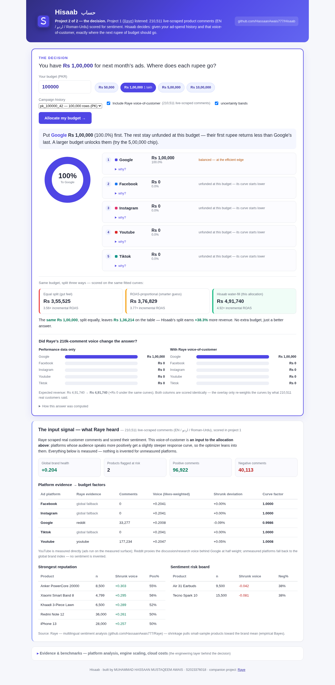
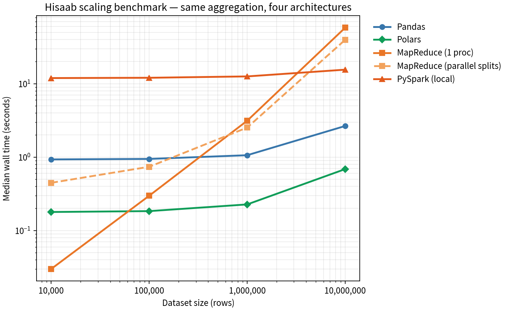

<p align="center">
  
</p>

<h1 align="center">Hisaab <span lang="ur">حساب</span></h1>

<p align="center">
  <b>Digital-ad budget optimization on big data</b> — one aggregation contract, four compute
  engines, saturation-curve budget allocation, and a sentiment bridge from our companion
  project <a href="https://github.com/HassaanAwais777/Raye">Raye</a>.
</p>

<p align="center">
  <a href="#benchmarks"></a>
  <a href="backend/tests"></a>
  
  
  
</p>

**Hisaab** (Urdu: *calculation, accounts*) answers one question a marketing director actually
asks: **"Next month's budget — where does each rupee return the most?"** It ingests
campaign-level ad data (Facebook / Instagram / Google / TikTok / YouTube), computes the
standard funnel metrics, benchmarks four ways of computing them at 10k → 10M rows, and then
*allocates* the budget with fitted saturation curves — not gut feeling.

It is the second half of a two-project story:
**Raye** listens (210,511 live-scraped comments of multilingual product sentiment) →
**Hisaab** decides (where the money goes).

---

## The 30-second decision — "I have Rs 1,00,000. Where does it go?"

Open the dashboard, type your budget (or tap the **Rs 1,00,000 — 1 lakh** chip), press
**Allocate my budget →**:

<p align="center"></p>

- **The answer first** — "Put Google Rs 4,31,136 (86.2%) first", with every platform's
  rupees, share and saturation status in one ranked list.
- **The why, one click away** — per-platform expected revenue, marginal ROAS at the
  allocation edge, the fitted curve α/β/R² with bootstrap CIs, and the Raye evidence line
  ("33,277 live-scraped reddit comments → curve scaled ×0.9986").
- **The proof** — the *same* budget scored three ways under the same fitted curves:
  equal split (gut feel) → ROAS-proportional → Hisaab water-fill. At Rs 5,00,000 the
  equal split leaves **Rs 4,70,520 on the table** (+27.7% revenue from a better split,
  not a bigger budget).
- **The Raye overlay, visible** — a side-by-side split shows exactly how many rupees the
  210,511-comment voice-of-customer re-allocates; both columns are re-scored identically,
  and platforms Raye never measured fall back to the global index (nothing invented).
- Platform KPIs, engine benchmarks and cloud costs sit in one collapsed **"Evidence &
  benchmarks"** section — the engineering layer *backs* the decision instead of replacing it.

## Highlights

- **One contract, four engines** — Pandas, Polars, PySpark (real JVM, local[2]) and a
  from-scratch **MapReduce** (map / combine / shuffle / reduce, Hadoop-Streaming scripts
  included) all answer the *same* aggregation question. A 34-test suite proves they return
  identical raw sums, so the benchmark measures **architecture**, not accuracy.
- **Honest benchmarking** — every run executes in an isolated subprocess with peak-RSS
  accounting (`ru_maxrss`); Spark's JVM startup is counted, not hidden; MapReduce reads the
  CSV text stream like Hadoop Streaming does; DataFrame engines read Parquet. Medians of
  3 runs, disclosed machine.
- **L3 recommender** — per-platform revenue response `R(s) = a·ln(1+s/β) + c` fitted on
  weekly aggregates (closed-form OLS over a β grid, bootstrap CIs), then **water-filling**:
  equalize marginal returns `a/(β+x) = λ`. Saturated platforms earn **zero** — the math
  refuses to fund them. Three baselines are scored under the same curves — equal split,
  L1 ROAS-proportional, L2 empirical-Bayes shrinkage — and L3 beats them all (+38% over
  an equal split at the 1-lakh budget; +11.7% / +12.1% over L1/L2 on the 1M-row demo).
- **Raye sentiment bridge** — brand health from 210,511 analysed comments (EN / اردو /
  Roman-Urdu) enters as a multiplier on the curve scales. Measured surfaces only: YouTube
  is direct evidence, Reddit proxies the discussion voice behind Google (0.5 weight),
  unmeasured platforms fall back to the global index — **no sentiment is invented**.
  Includes an empirical-Bayes product risk board (shrinkage toward the brand mean).
- **Dual locale** — `pk` (PKR, Karachi/Lahore/…, Ramadan + 11.11 seasons) and `global`
  (USD, tier-1 mix, Black Friday), same generator, same optimizer.

## Benchmarks (measured, not aspirational)

2 vCPU sandbox · Python 3.12.16 · median of 3 isolated runs · task: group-by platform,
sum 5 metrics. DataFrame engines read Parquet (zstd); MapReduce reads the CSV text stream.

| Engine | 10,000 rows | 100,000 rows | 1,000,000 rows | 10,000,000 rows |
|---|---:|---:|---:|---:|
| **Polars** | 0.18 s | 0.18 s | 0.23 s | **0.69 s** |
| **Pandas** | 0.93 s | 0.94 s | 1.06 s | 2.65 s |
| **MapReduce (1 proc)** | 0.03 s | 0.30 s | 3.13 s | 57.87 s |
| **MapReduce (parallel splits)** | 0.45 s | 0.74 s | 2.52 s | 39.58 s |
| **PySpark (local[2])** | 11.93 s | 12.04 s | 12.57 s | 15.53 s |

<p align="center"></p>

What the lines say:

- **Polars** wins everywhere in-process — columnar + multi-core, and it shows.
- **Spark's cost is the JVM**: ~12 s flat across four orders of magnitude of data; by 10M
  rows the *processing* is only ~3 s of that. Buy-in vs slope, visible.
- **MapReduce pays the Hadoop tax**: pure-Python streaming loses at scale, but the
  parallel-splits variant claws back 1.5× — and it is the only engine that translates
  line-for-line to a real Hadoop cluster (`hadoop_streaming/mapper.py` + `reducer.py`).
- Peak RSS and a cloud cost model (EMR/on-demand list prices) ship in
  [`backend/results/`](backend/results).

## The recommender, in one picture

```
weekly (platform, spend, revenue) ──► fit R(s)=a·ln(1+s/β)+c  ──►  water-filling
                                        │ (bootstrap CIs)          xᵢ(λ)=aᵢ/λ−βᵢ
                                        │                          until Σxᵢ = B
Raye brand health (210,511 comments) ───┤
  youtube ─ direct evidence             ├──► sentiment factors × aᵢ ──► L3 + Raye split
  reddit  ─ 0.5-weight proxy for google │
  others  ─ global fallback (honest)    └──► product risk board (empirical-Bayes)
```

Measured on the 1M-row PK demo (`scripts/demo_recommend.py`, budget Rs 1,000,000):

| Platform | L3 allocation | L3 + Raye | Raye factor |
|---|---:|---:|---:|
| google | Rs 656,921 (65.7%) | Rs 655,451 | 0.9986 |
| facebook | Rs 274,128 (27.4%) | Rs 274,715 | 1.0000 |
| instagram | Rs 59,273 (5.9%) | Rs 59,769 | 1.0000 |
| youtube | Rs 9,678 (1.0%) | Rs 10,065 | 1.0008 |
| tiktok | Rs 0 (starved — its curve earns it nothing at the margin) | Rs 0 | 1.0000 |

Raye's corpus has a *uniform platform voice* (±0.3%), so the overlay nudges by ≤1% — the
machinery responds to signal strength, it doesn't manufacture drama. What the same corpus
*does* differentiate sharply is **products** (spread 0.45): Tecno Spark 10 (38% negative) and
Air 31 Earbuds are flagged on the risk board, Anker PowerCore and Xiaomi Band 8 lead it.
And the overlay is crisis-ready: set YouTube's voice to −0.20 in a what-if and its factor
drops to 0.88 (the ±12% cap), its allocation drops to zero, and the freed budget flows to
Google/Facebook/Instagram automatically. That scenario ships in
`backend/results/demo_recommend.json`.

## Repository layout

```
Hisaab/
├── backend/
│   ├── app/
│   │   ├── generator/        # calibrated synthetic data (PK + Global), traps included
│   │   ├── metrics/          # cleaning, aggregation, CTR/CPC/CPA/CVR/ROAS formulas
│   │   ├── engines/          # pandas | polars | spark | mapreduce (+ parallel splits)
│   │   ├── recommender/      # curves.py, allocate.py (water-fill), baselines.py
│   │   ├── sentiment/        # bridge.py (Raye export), adjust.py (factors, risk board)
│   │   ├── benchmark/        # isolated-run harness, cloud cost model, chart
│   │   ├── api/              # FastAPI routes
│   │   └── ...
│   ├── hadoop_streaming/     # mapper.py / reducer.py — runnable on a real Hadoop cluster
│   ├── scripts/              # generate · benchmark · demo_recommend · export_raye
│   ├── tests/                # 34 tests — engine parity, curve recovery, water-fill properties
│   └── data/raye/            # committed Raye aggregates + 25k-row sample
├── frontend/                 # React + TS dashboard (Vite)
├── docs/                     # ARCHITECTURE · API · LAB_GUIDE · GITHUB_SETUP
└── assets/                   # banner + logo
```

## Quickstart

### One-command demo (no Node needed — the dashboard ships pre-built)

```bash
cd backend
pip install -r requirements.txt
uvicorn app.main:app --port 8000      # http://localhost:8000 = dashboard + API + /docs
```

If the registry is empty, click **"create a 100k-row demo dataset"** in the UI, tap the
**Rs 1,00,000 — 1 lakh** chip, and allocate. That's the whole demo.

### Development mode

```bash
# backend
cd backend
python -m venv .venv && source .venv/bin/activate
pip install -r requirements.txt
uvicorn app.main:app --reload --port 8000     # API on :8000, docs on /docs

# dashboard (second terminal)
cd frontend
npm install && npm run dev                    # Vite on :5173, proxies /api → :8000
```

Generate data and reproduce every number:

```bash
cd backend
python scripts/generate.py --rows 1000000 --locale pk        # dataset (parquet + csv twin)
python scripts/benchmark.py --scales 10000,100000,1000000,10000000
python scripts/demo_recommend.py 1000000                     # the table above
python scripts/export_raye.py --db /path/to/raye.db          # refresh the sentiment bridge
pytest -q                                                    # 34 tests
```

Optional PySpark: `pip install -r requirements-spark.txt` (needs Java 17/21).

Full walkthrough incl. the university/Hadoop lab flow: **[docs/LAB_GUIDE.md](docs/LAB_GUIDE.md)** ·
API reference: **[docs/API.md](docs/API.md)** · internals: **[docs/ARCHITECTURE.md](docs/ARCHITECTURE.md)**.

## The data contract

`date, campaign, platform, impressions, clicks, spend, conversions, revenue, age, gender,
city, device` — twelve columns, campaign-level grain, two calibrated locales. The generator
injects realistic traps **on purpose**: ~1% impression-fraud rows (huge impressions, zero
clicks), ~2% viral outliers, ~0.5% exact duplicates — the documented cleaning policy
(top-0.5%-impressions ∧ zero-clicks drop, exact-duplicate drop) has something real to do,
and the engines are tested against the raw stream either way.

## Testing

```bash
cd backend && pytest -q        # 34 passed
```

The suite pins the mathematical properties that make the product defensible: all four engines
return identical raw sums; fitted curves recover known α/β from clean data; marginal ROAS is
strictly decreasing; water-filling always sums to budget and starves saturated platforms;
the sentiment overlay stays within its ±12% cap on real data and shifts budget *monotonically*
with voice; L3 ≥ L1/L2 under the same curves.

## Author

Built by **MUHAMMAD HASSAAN MUSTAQEEM AWAIS** · S2023376018 ·
[github.com/HassaanAwais777](https://github.com/HassaanAwais777) ·
companion project: [Raye](https://github.com/HassaanAwais777/Raye) — multilingual sentiment
analysis (EN / اردو / Roman-Urdu).

Cite via [CITATION.cff](CITATION.cff). Licensed MIT — see [LICENSE](LICENSE).
